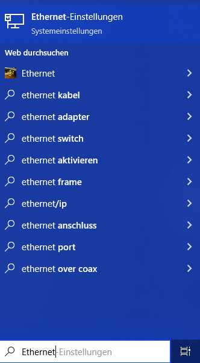

# Saltychat ("Man wird nicht gemovt")

Aufgrund fehlender DNS Einstellung kann es vor kommen, dass man nicht in den Spiel-Channel gemovt wird. \
Um dies wieder nutzen zu können, müssen kleinere Einstellungen vorgenommen werden.\
\
Um die DNS Einstellungen vorzunehmen, benötigt man wenige Schritte. \
Diese werden Anhand von Windows 10 inklusive Ethernet-Verbindung gezeigt. \
Für Windows 11 sowie WLAN Einstellungen liegt ebenfalls nochmals ein Tutorial-Video im Anhang.



Suche in der Suchleiste nach <mark style="color:purple;">Ethernet</mark> und anklicken. 

<figure><figcaption></figcaption></figure>



Nun das gewünschte <mark style="color:purple;">Ethernet</mark> auswählen 

<figure><figcaption></figcaption></figure>



Nun klicke bei IP-Einstellungen auf <mark style="color:purple;">Bearbeiten</mark> und gebe <mark style="color:purple;">Manuell</mark> an 

<figure><figcaption></figcaption></figure>



Setze nun die Felder von <mark style="color:purple;">IPv4</mark> sowie <mark style="color:purple;">IPv6</mark> auf <mark style="color:green;">AN</mark> 

<figure><figcaption></figcaption></figure>



Gebe nun im Feld von <mark style="color:purple;">IPv4</mark> bei folgenden Feldern, folgender Inhalt ein:\
\- <mark style="color:purple;">Bevorzugter DNS</mark>\
<mark style="background-color:red;">8.8.8.8</mark>\
\- <mark style="color:purple;">Alternativer DNS</mark>\
<mark style="background-color:red;">8.8.4.4</mark> 

<figure><figcaption></figcaption></figure>



Ebenfalls nun im Feld von <mark style="color:purple;">IPv6</mark> bei folgenden Feldern, folgender Inhalt ein:\
\- <mark style="color:purple;">Bevorzugter DNS</mark>\
2001:4860:4860::8888\
\- <mark style="color:purple;">Alternativer DNS</mark>\
2001:4860:4860::8844 

<figure><figcaption></figcaption></figure>

Nun nurnoch auf <mark style="color:purple;">Speichern</mark> und die DNS Einstellungen sind beendet





