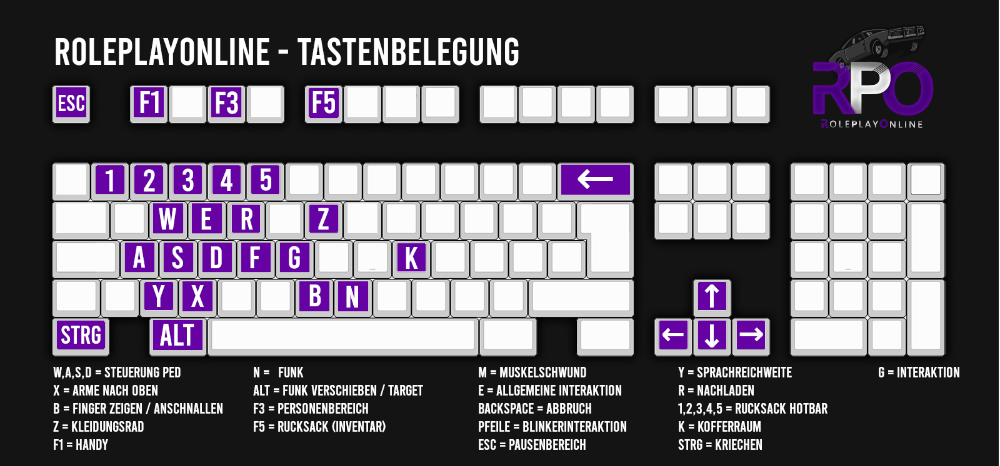

# Tastenbelegung

Unter <mark style="background-color:red;">Einstellung -> Tastenbelegung -> FiveM</mark> kannst du sämtliche Tastenbelegungen beliebig umändern

<figure><figcaption></figcaption></figure>
